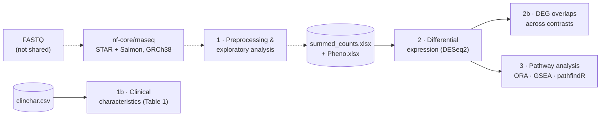

<h1 align="center">Transcriptomic signatures of recurrence in tongue squamous cell carcinoma</h1>

<p align="center">
  
  
  
  
</p>

---

## Scope

This repository contains the analysis code and outputs for a bulk RNA-seq study of **tongue squamous cell carcinoma (TSCC)**. It asks which genes and pathways distinguish tumors that went on to **recur** from those that did not, and whether that signal depends on **tumor stage** (pathological T stage).

| | |
|---|---|
| **Cohort** | 40 FFPE samples (32 tumors and 8 adjacent normal tissues) from 34 patients. Each sample was sequenced on two lanes (read 1 only), and the lane counts were summed per sample |
| **Analyzed set** | 32 tumors: early stage (T1–T2) and late stage (T3–T4), with and without recurrence |
| **Model** | `DESeq2` Wald test, `~ Stage * Recurrence`, with IHW p-value weighting and `ashr` LFC shrinkage |
| **Downstream** | DEG overlap statistics, ORA, GSEA and active-subnetwork enrichment (`pathfindR`) |

<table>
  <tr><th></th><th>Early (T1–T2)</th><th>Late (T3–T4)</th></tr>
  <tr><td><b>Recurrence</b></td><td align="center">7</td><td align="center">8</td></tr>
  <tr><td><b>No recurrence</b></td><td align="center">9</td><td align="center">8</td></tr>
</table>

### Contrasts

| Code | Comparison |
|---|---|
| `TR_vs_TNR` | Recurrent vs non-recurrent tumors (stage-balanced) |
| `ETR_vs_ETNR` | Early-stage: recurrent vs non-recurrent |
| `LTR_vs_LTNR` | Late-stage: recurrent vs non-recurrent |
| `LTR_vs_ETR` | Recurrent tumors: late vs early stage |

---

## Workflow

Dashed steps document how the count matrix was produced. They need the raw sequencing data, which are not shared, so they cannot be rerun from this repository.



| Step | Script | What it does |
|---|---|---|
| 0 | [`nextflow/nf_job.sh`](nextflow/nf_job.sh) | Template of the upstream `nf-core/rnaseq` job (Ensembl GRCh38.112), with placeholder paths. Needs raw data |
| 1 | [`1. Preprocessing_and_exploratory_analysis.R`](R_Scripts/1.%20Preprocessing_and_exploratory_analysis.R) | `tximport` of Salmon quantifications, filtering, summing the two lanes of each sample, normalization, VST/rlog, distance heatmaps, PCA / GLM-PCA / MDS. Needs raw data; its outputs are provided |
| 1b | [`1.b. clinchar_stats.R`](R_Scripts/1.b.%20clinchar_stats.R) | Group comparisons of clinicopathological variables (Fisher, Kruskal–Wallis, Wilcoxon; BH-adjusted), exported as Table 1 and a statistics workbook |
| 2 | [`2. DGEA.R`](R_Scripts/2.%20DGEA.R) | `DESeq2` interaction model on tumors, IHW diagnostics, `ashr` shrinkage, MA / volcano plots, DEG heatmaps |
| 2b | [`2.b. DGEA_overlaps.R`](R_Scripts/2.b.%20DGEA_overlaps.R) | Pairwise DEG overlap between contrasts: Fisher tests, Jaccard / signed Jaccard, sign concordance, recovery; multi-panel figure |
| 3 | [`3. Pathway_analysis.R`](R_Scripts/3.%20Pathway_analysis.R) | ORA and GSEA (`clusterProfiler`, `ReactomePA`) plus `pathfindR` active-subnetwork analysis across KEGG, Reactome, BioCarta and GO |
| — | [`fast_pathfindR_hclust.R`](R_Scripts/fast_pathfindR_hclust.R) | Faster drop-in kappa-matrix / hierarchical clustering for `pathfindR` term clustering (via `fastcluster`) |

---

## Repository structure

```text
tscc_recurrence/
├── nextflow/                     # Template of the upstream nf-core/rnaseq job (paths are placeholders)
├── R_Scripts/                    # Analysis scripts, numbered in run order
├── Resources_and_environments/   # Inputs and saved R objects
│   ├── summed_counts.xlsx        #   lane-summed gene counts, 40 samples (starting point)
│   ├── Pheno.xlsx                #   sample groups: stage, sample type, recurrence
│   ├── final_dds.rds             #   final DESeq2 object (tumors)
│   └── *_sessionInfo.txt         #   package versions for each step
├── Results/
│   ├── Exploratory analysis/     # QC, density, distance and dim-reduction plots
│   ├── DGEA/
│   │   ├── DGEA_raw.xlsx         #   DE results, unshrunk LFCs (one sheet per contrast)
│   │   ├── DGEA_ashr.xlsx        #   DE results, ashr-shrunk LFCs
│   │   ├── IHW_diagnostics/
│   │   ├── MA_plots/  Volcano_plots/  Post_DGEA_heatmaps/
│   │   └── Overlaps/             #   cross-contrast overlap matrices and figure
│   └── Pathways/
│       ├── ashr_<contrast>/      #   ORA/, GSEA/, pathfindR/<database>/
│       └── archived/             #   earlier stage-only contrasts
├── Reports/                      # Internal R Markdown report (+ rendered HTML) and its figures
├── Tables/                       # Table 1 (.csv, .docx) and clinical statistics workbook (.xlsx)
├── clinchar.csv                  # Clinical characteristics per sample
└── tscc_recurrence.Rproj         # RStudio project (run scripts from the repository root)
```

---

## Reproducing the analysis

Raw sequencing data are not publicly available. The analysis can be reproduced from the lane-summed gene counts, which are also provided as Supplementary File 3 of the article.

1. Clone the repository and open `tscc_recurrence.Rproj`, or set the working directory to the repository root. All paths are relative to it.
2. Run the scripts in this order:
   - `1.b. clinchar_stats.R`: clinical comparisons and Table 1, from `clinchar.csv`. It is independent of the expression analysis.
   - `2. DGEA.R`: builds the DESeq2 object from `summed_counts.xlsx` and `Pheno.xlsx`, then runs the differential expression analysis. This gives the same model fit as `final_dds.rds`.
   - `2.b. DGEA_overlaps.R`: DEG overlaps. It loads the environment saved by script 2.
   - `3. Pathway_analysis.R`: enrichment analyses. KEGG-based steps need an internet connection.
3. Script 1 starts from the nf-core/rnaseq outputs and cannot be rerun from the beginning without the raw data. Its outputs (the count matrix and the exploratory figures) are included. `summed_counts.xlsx` contains the count matrix that is used for the `DESeq2 dds` object creation and can therefore be imported to reproduce steps from then onwards in this script.

Package versions for each step are recorded in `Resources_and_environments/*_sessionInfo.txt`. Intermediate `.RData` environments are not tracked; each script recreates the ones the next script needs.
